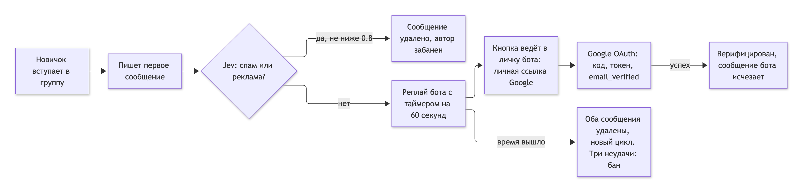

# Telegram-Google-Auth-Jev-verify-bot


Антиспам-бот для Telegram-группы: новичок должен подтвердить, что он человек, через вход в Google. Явный спам и рекламу в первом сообщении отсекает ИИ-модель.

## Проблема

В открытые чаты постоянно заходят боты и рекламщики: они пишут одно сообщение со ссылкой и исчезают. Обычные капча-боты ломаются, а ручная модерация не успевает.

## Как это работает



<sub>Исходник схемы: [docs/flow.mmd](docs/flow.mmd) (Mermaid). Картинка вместо встроенного блока, чтобы схема отображалась везде.</sub>

- Первое сообщение новичка остаётся, пока идёт проверка; остальные его сообщения за эти 60 секунд удаляются.
- Таймер в сообщении бота обновляется каждую секунду.
- Ссылку на вход бот выдаёт только тому, для кого создана проверка (определяется по `from.id`, а не по ссылке).
- Один Google-аккаунт можно привязать только к одному участнику Telegram.
- Google-вход требуется только от вступивших после запуска бота. Сообщения старых участников (которых нет в базе) Google-проверку не проходят, но их текст тоже смотрит Jev: явный спам и реклама удаляются сразу, автор блокируется.
- Явный спам в первом сообщении новичка (вероятность выше порога) удаляется сразу, автор блокируется вместе со всеми своими сообщениями, проверка Google ему не предлагается.

## Модели

| Модель | Где | Для чего |
|---|---|---|
| `typesafe/jev-1.13` (Jev, System One) | через OpenRouter, `POST /api/alpha/decisions` | классификация первого сообщения: вероятность «блокировать» (спам, реклама, мошенничество) и категория; ~0,6 с, $0,042 за 1 млн входных токенов |

Jev возвращает не текст, а типизированное решение с вероятностью, поэтому порог (`SPAM_THRESHOLD`, по умолчанию 0.8) настраивается без разбора ответа. Если ключа нет или сервис недоступен, проверка пропускается и сообщение идёт обычным путём.

## Решения и стек

| Что | Решение | Почему |
|---|---|---|
| Бот | Python 3.12, aiogram 3, **polling** | один постоянный процесс, не нужен публичный webhook |
| Веб-часть | FastAPI + uvicorn | обратный вызов Google (`/auth/google/callback`) и `/health` |
| Вход | **Google OAuth 2.0** (authorization code) | подтверждение живого аккаунта; одноразовый `state`, проверка `email_verified` |
| OAuth-клиент | создан в проекте **Firebase** (Google Cloud) | удобно управлять из консоли; Firebase SDK и Firestore в рантайме не используются |
| База | PostgreSQL (asyncpg) | участники, сессии, одноразовые state, привязки Google, журнал событий |
| Хостинг | **Railway**, автодеплой из GitHub | один сервис + база; настройки как код в `.railway/railway.ts` |
| Миграции | нумерованные SQL, только вперёд | применяются по флагу `RUN_MIGRATIONS=1` |

Рассматривали и отказались: Firebase Functions и Firestore (нужен платный план, посекундный таймер неудобен), n8n (лишний слой), webhook вместо polling (публичный адрес и холодные старты без выгоды).

## Безопасность

- Секреты только в переменных окружения, в коде и базе их нет.
- Google ID хранится как HMAC-хэш.
- Текст сообщений, которые проверила модель, пишется в таблицу `screened_messages` вместе с решением (`blocked` / `passed` / `unchecked`), вероятностью и категорией, чтобы владелец видел, что блокируется и что проходит. Храните доступ к базе как к персональным данным.
- Блокировки и события видны в таблице `events`.

## Запуск

```bash
pip install -r requirements.txt
# задать переменные окружения из .env.example (BOT_TOKEN, CHAT_ID, DATABASE_URL, GOOGLE_*, ...)
RUN_MIGRATIONS=1 python main.py   # первый запуск создаёт таблицы
```

Бот читает только переменные окружения (файл `.env` сам не загружается): на Railway их задают в Variables сервиса.

Бот должен быть администратором группы с правами «Удалять сообщения» и «Блокировать участников». Адрес обратного вызова Google: `<PUBLIC_BASE_URL>/auth/google/callback`.

## Проверка

```bash
pip install -r requirements-dev.txt
TEST_DATABASE_URL=postgresql://postgres@127.0.0.1:5432/postgres pytest
```

57 тестов на реальном PostgreSQL (Telegram и OpenRouter подменяются). Тесты сбрасывают схему, поэтому принимают только локальные адреса.
